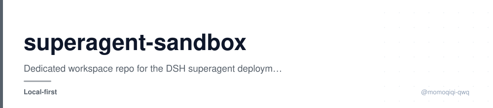

**Dedicated workspace repo for the DSH superagent deployment …**

---

# superagent-sandbox

Dedicated workspace for the DSH superagent deployment. Issues opened here are picked up by the
agent, which works on a ticket branch and replies with a pull request.

## Notes

- One issue, one change.
- Pull requests are opened by the agent; a human merges them.
- The agent receives issues from this repository and replies with pull requests.